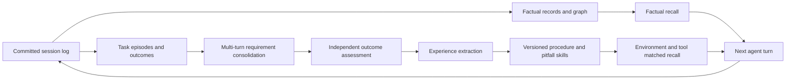

# dsh-advanced-mem-plugin

English | [中文](README.zh.md)

Cross-session **factual and experience memory** for [DeepSeek Harness](https://github.com/deepseek-ai/deepseek-harness), distributed as an installable Cordis bundle. It preserves user knowledge, learns reusable procedures from completed tasks, and brings the appropriate memory into the next task. The same experience engine and evaluation interfaces are available as TypeScript APIs.



The factual channel remembers what is known about the user and workspace. The experience channel remembers how to complete a class of tasks, under which conditions, and how to check the result. Separate storage, provenance rules and recall budgets keep these meanings distinct.

## Compatibility and installation

Plugin **0.3.0** targets **DeepSeek Harness `dsh-v0.2.1-rc.2`**, official commit [`687f282e`](https://github.com/deepseek-ai/deepseek-harness/commit/687f282e8625c6b8d11ff58211a90524be2e4317). See the [compatibility report](docs/compatibility.md) for the verified API changes and checks. Use the Node version required by that Harness release. The standard `web` profile supplies the model, storage and agent services used by the bundle.

```sh
npm install -g @deepseek-ai/dsh@0.2.1-rc.2
dsh plugin --profile web add ./dsh-advanced-mem-plugin-0.3.0.tgz
dsh web
```

`dsh web` starts the local GUI and automatically opens an authenticated browser URL containing an access token. The default local address is [http://127.0.0.1:3080](http://127.0.0.1:3080); use the tab opened by the launcher. Configure a provider in **Settings → Models**, then open a workspace session and select its model. Task understanding, outcome assessment and experience extraction use that selection and the authentication already managed by Harness. Complete a task with a final test or artifact readback, then inspect `/experience list`; follow-up requirements can stay in the same session.

A pinned Git revision can also be installed with `dsh plugin --profile web add github:CenYangtze/dsh-advanced-mem-plugin#<commit>`. Git installation builds `lib/` with the package's `prepare` script. If pnpm requests build approval, add the package to the profile's `pnpm-workspace.yaml`, then repeat installation:

```yaml
allowBuilds:
  dsh-advanced-mem-plugin: true
```

To build and install the release archive from source:

```sh
pnpm run build
pnpm pack
dsh plugin --profile web add ./dsh-advanced-mem-plugin-0.3.0.tgz
```

The shipped patch mounts ten plugin rows. The feature-hash embedding provider is available as an optional entry point; the default factual retrieval uses lexical ranking and graph activation. All Harness packages remain peers and are resolved from the host installation.

## Use factual memory

Factual capture reads committed session events. Direct user messages and explicitly invoked skills can support beliefs about the user; assistant output and tool invocations remain evidence and are excluded from ordinary recall and user-preference mining.

- `memory_search`: retrieve factual knowledge in the current scope chain.
- `memory_write`: record a note or supported belief.
- `memory_forget` with `mode: "erase"`: erase source records and propagate deletion to dependent experience; the default `retract` mode retains history.
- `/memory`, `/memory search <query>`, `/memory stats`: inspect the factual channel.
- `/memory forget <label>`: retract a named belief, preserving its audit history.

The semantic graph keeps source-record citations, confidence, support, decay and supersession. BM25, optional embeddings and graph activation share the same reciprocal-rank transform. Automatic factual recall is appended once per turn and preserves the Harness request-series boundary.

## Learn and use experience

The default `modelSettings.mode: inherit` with `extractionMode: harness` follows the current session's **provider, model and authentication**. No additional experience API configuration is required. Requirement consolidation, outcome assessment and skill extraction run as separate auxiliary requests through the host LLM service, with explicit budgets and no tools. A model change applies to subsequent memory requests; sessions without a selected route use the Harness default model.

A task can span planning, implementation, correction and additional requirements. The model consolidates the original user requests into versioned `taskContext` checkpoints, preserving requirements that still apply and interpreting temporary instructions within their stated scope. Original requests govern consolidation: the model corrects added conditions in earlier summaries and keeps required results distinct from explicitly requested implementation methods. Planning rounds preserve context; executable experience is extracted after tool work. A new increment is assessed against fresh verification after its final changes.

The shipped policy enables `autoConfirm`, `autoLearn` and `autoFeedback`. The observer captures visible actions and results from committed events, including nested PTC dispatches. An independent assessment checks every material acceptance criterion against exact quotations from complete tests or artifact readbacks. Runtime checks enforce evidence identity, execution order, coverage and confidence before accepting a `tool-evidence` outcome. A turn boundary or an assistant's completion claim alone leaves the result unknown.

Auxiliary assessment selects evidence by event ID and line range; the runtime restores and stores the exact source quotation, while ordinary recall keeps procedures and compact source counts.

A completed text readback with intact tool metadata and execution order can be shortened to fit the local capture budget while preserving the execution trace. Its shortened content provides background only; final confirmation uses complete checks or readbacks after the last possible state change.

Tasks with unresolved requirements, incomplete evidence or an unavailable assessment remain pending. Use `/experience pending` to inspect the reason. Service or response-parsing failures with complete evidence receive bounded maintenance retries; `/experience assess <episode-id>` re-examines the existing evidence immediately with the configured model. Substantive uncertainty is kept visible rather than repeatedly reassessed. Continue the task with new verification, or explicitly confirm a result you have checked. A host evaluator can submit a verified task through `experience/task-completed`.

```text
/experience list
/experience pending
/experience assess <episode-id>
/experience confirm <episode-id> success
/experience learn
/experience show <skill-id>
/experience sources <skill-id>
/experience export <skill-id>
/experience retract <skill-id>
/experience forget episode <episode-id>
/experience forget skill <skill-id>
/experience forget all
/experience maintain
```

Manual confirmation also accepts `failure` and `partial`, and persists the user's confirmation as source evidence. Extraction produces procedures and pitfalls with applicability, preconditions, steps, cautions, verification, required tools, environment constraints and source episodes. Active skills meet the configured confidence and independently supported outcome thresholds.

Recall selects active, unexpired skills matching the task, environment and available tools. Each turn receives a compact procedural block with source counts. The model can call `experience_inspect` to expand the skill, its source index grouped by session, or a selected episode's quoted verification. `/experience sources` exposes the same source index to the user. Host instructions, permissions and approval policies continue to govern execution.

Export produces a Harness-compatible `SKILL.md` with YAML name and description, lifecycle metadata and source references. Save it under `.agents/skills/<exported-name>/SKILL.md` when you choose to install it as a workspace skill.

### Choose a memory model

The plugin's **Memory model** configuration page provides three choices:

| Mode | Behavior |
|---|---|
| `inherit` — Follow the current session | Use the session's provider/model and the Harness default when no session is available. |
| `harness` — Choose another Harness model | Select a configured provider and model for memory processing, with optional reasoning effort; authentication stays with Harness. |
| `api` — Use an independent API | Supply a complete OpenAI-compatible `chat/completions` endpoint, model and optional credential reference. |

Save the selection to apply it to subsequent memory requests. The API-key input writes through the host credential service; plugin configuration stores its reference. Leaving the key input blank keeps the saved credential.

Environment-based API deployments remain supported. Copy the complete `experience-harness` row configuration from [cordis.patch.yml](cordis.patch.yml) into the profile override, set `extractionMode: api`, and keep `modelSettings.mode: inherit`. Profile patches replace the entire `config`, so retain all other fields and your deployment values. Then provide the endpoint, model and credential in the environment used to start Harness:

```powershell
$env:DSH_EXPERIENCE_ENDPOINT = 'https://your-provider.example/v1/chat/completions'
$env:DSH_EXPERIENCE_MODEL = 'your-model'
$env:DSH_EXPERIENCE_API_KEY = 'your-api-key'
dsh web
```

Bash and Zsh use `export NAME=value` for the same variables. A local unauthenticated API may leave the key empty. An explicit environment-based API deployment keeps that selection in `inherit` mode. The `web` profile patch lives at `$DSH_HOME/profiles/web/cordis.patch.yml`, with `DSH_HOME` defaulting to `~/.dsh`. To follow the session again, restore `extractionMode: harness` in the complete row config.

## Lifecycle and deployment policy

| Operation | Persistent behavior |
|---|---|
| Deduplicate | Merge new supporting episodes into an equivalent procedure; repeated extraction adds no extra vote. |
| Validate | Record evaluator or user confirmation as an immutable episode; retain the earlier outcome. |
| Apply feedback | Attribute later independent task actions and final verification to the exact recalled skill version, then update confidence and isolate repeatedly harmful skills. |
| Replace | Activate an evidence-backed successor and retain the predecessor and version history. |
| Expire | Filter expired skills during retrieval, even before maintenance runs. |
| Retract | Keep a tombstone and audit history. |
| Forget | Erase the selected material and its derived skills, revisions, feedback and confirmation descendants. Forgetting a skill also erases its source episodes and other skills sharing those episodes; use retract to withdraw only one skill. |
| Reach capacity | Reject additional writes explicitly; reclaim space through export and deliberate erasure. |

Every policy value is explicit in [cordis.patch.yml](cordis.patch.yml). Override a row by its `id` in the profile patch and supply its complete `config`; copy the corresponding shipped row before changing individual values. Profile overrides replace that config rather than merging its fields. Configure `environment` entries such as `browser=chromium` and `application=libreoffice-24`; the local OS is added automatically. `availableTools` optionally narrows the current agent's tool registry. Capture and extraction budgets, TTLs, outcome weights and promotion thresholds are deployment settings.

Maintenance runs after recorded work and periodically for recently used scopes. `maxReassessmentsPerMaintenance` bounds retries of eligible assessment-service failures in each maintenance pass. Automatic feedback requires evidence that the recalled procedure was applied and relevant final verification; retrieval alone adds no feedback.

The Harness provider stores complete experience-scope snapshots in a separate `experience` storage domain. The standalone `FileExperienceStore` uses atomic replacement and an exclusive writer lease. Each tenant should have its own runtime/store or explicit scope namespace. [Architecture and design](docs/design.md) describes the storage and consistency contracts.

## Programmatic API and evaluation

```ts
import {
  ExperienceMemory, FileExperienceStore, createOpenAIExperienceDistiller,
} from 'dsh-advanced-mem-plugin/experience/api'
import {
  loadLongMemEval, loadLoCoMo, evaluateDataset,
  createApiAgentFactory, createHarnessMemoryFactory, JsonlCheckpoint,
} from 'dsh-advanced-mem-plugin/evaluation'
```

The experience API supports `record`, `learn`, `propose`, `confirmOutcome`, `recall`, `feedback`, `maintain`, `retract`, `forget`, `snapshot` and `export`. Harness consumers access the same engine through `ctx.experience.memory`.

The evaluation API provides **LongMemEval**, **LoCoMo** and **OSWorld** adapters. QA runs use isolated namespaces and keep references out of agent input. Runs save a manifest, sample results, latency, token usage and resumable checkpoints. OSWorld uses a Python HTTP bridge to the real `DesktopEnv` reset/step/evaluate lifecycle; its official environment evaluator supplies the task score. Frozen experience banks keep learning and held-out evaluation separate.

See [the evaluation guide](docs/evaluation.md) for executable API examples, dataset formats, API configuration, metrics and OSWorld deployment. Evaluation artifacts and model smoke-test helpers belong outside the source tree; the published package contains the runtime and adapters.

## Development

```sh
# Build the supported official Harness checkout first, following its instructions.
pnpm install
pnpm run link-harness ../deepseek-harness
pnpm run check
```

`check` runs type checking, the existing regression suite, the package build and export/plugin-shape verification. The verifier distinguishes service plugins, function plugins and programmatic API libraries. No `@deepseek-ai/*` dependency is bundled.

| Directory | Responsibility |
|---|---|
| `src/memory/` | Factual vocabulary, scoring, providers, retrieval and graph lifecycle |
| `src/memory-store-domain/` | Durable factual records, nodes and edges |
| `src/memory-observer/`, `src/memory-consolidation/` | Event capture and factual distillation |
| `src/memory-recall/`, `src/tool-memory/`, `src/command-memory/` | Factual model and user interfaces |
| `src/experience/` | Portable experience engine, schema, API extraction, file store and skill export |
| `src/experience-store-domain/` | Harness experience persistence |
| `src/experience-harness/` | Task capture, current-model extraction, recall, commands and lifecycle integration |
| `src/evaluation/` | Dataset readers, API clients, runners, checkpoints and OSWorld bridge |
| `bench/` | Existing retrieval-analysis utilities |

## Research basis

[ExpeL](https://arxiv.org/abs/2308.10144) motivates extracting reusable knowledge across task experiences. [ReasoningBank](https://arxiv.org/abs/2509.25140) motivates learning procedures and failure lessons from completed trajectories. This implementation adds explicit outcome provenance, separate factual and procedural stores, versioned lifecycle operations and environment-aware applicability.

## License

MIT. See [LICENSE](LICENSE).
