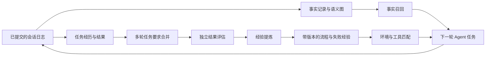

# dsh-advanced-mem-plugin

[English](README.md) | 中文

为 [DeepSeek Harness](https://github.com/deepseek-ai/deepseek-harness) 提供跨会话的**事实记忆与经验记忆**，以 Cordis bundle 形式安装。插件保存用户知识，从已完成任务中提炼可复用流程，并在后续任务中召回适用的经验。同一套经验引擎和评测接口也可通过 TypeScript API 使用。



事实通道回答“关于用户和工作区，已经知道什么”；经验通道回答“这类任务如何完成、需要哪些条件、怎样检查结果”。两个通道采用独立存储、来源规则和召回预算。

## 兼容版本与安装

插件 **0.3.0** 支持 **DeepSeek Harness `dsh-v0.2.1-rc.2`**，官方提交 [`687f282e`](https://github.com/deepseek-ai/deepseek-harness/commit/687f282e8625c6b8d11ff58211a90524be2e4317)。接口变化与验证结果见[兼容性报告](docs/compatibility.zh.md)。使用该 Harness 版本要求的 Node 环境；标准 `web` profile 已提供插件所需的模型、存储与 Agent 服务。

```sh
npm install -g @deepseek-ai/dsh@0.2.1-rc.2
dsh plugin --profile web add ./dsh-advanced-mem-plugin-0.3.0.tgz
dsh web
```

`dsh web` 启动本地 GUI，并自动在浏览器打开包含认证 token 的地址。默认本地地址为 [http://127.0.0.1:3080](http://127.0.0.1:3080)，使用启动器自动打开的标签页即可。在**设置 → 模型**中配置提供商，再打开工作区会话并选择模型。任务理解、结果评估和经验提炼复用该选择及 Harness 管理的认证。完成任务并执行最终测试或产物回读后，使用 `/experience list` 查看结果；后续要求可继续在同一会话中提出。

也可通过 `dsh plugin --profile web add github:CenYangtze/dsh-advanced-mem-plugin#<commit>` 安装固定 Git 修订。Git 安装通过 `prepare` 脚本生成 `lib/`。若 pnpm 要求允许构建，在 profile 的 `pnpm-workspace.yaml` 中加入以下配置，再次执行安装：

```yaml
allowBuilds:
  dsh-advanced-mem-plugin: true
```

从源码构建发布包并安装：

```sh
pnpm run build
pnpm pack
dsh plugin --profile web add ./dsh-advanced-mem-plugin-0.3.0.tgz
```

默认补丁挂载十个插件。特征哈希嵌入器作为可选入口提供；默认事实检索使用词法排序和图激活。所有 Harness 包均为 peer dependency，从宿主安装中解析。

## 使用事实记忆

事实采集读取已提交的会话事件。用户消息与显式调用的 Skill 可以支持关于用户的知识；助手输出和工具调用作为证据保存，排除在普通召回和用户偏好挖掘之外。

- `memory_search`：在当前作用域链中检索事实知识。
- `memory_write`：保存笔记或有依据的知识。
- `memory_forget` 配合 `mode: "erase"`：删除源记录，并传播到依赖它的经验；默认 `retract` 模式保留历史。
- `/memory`、`/memory search <query>`、`/memory stats`：查看事实记忆。
- `/memory forget <label>`：撤回指定知识，保留审计历史。

语义图保存源记录引用、置信度、支持度、衰减与替代关系。BM25、可选嵌入和图激活使用统一的倒数排名变换。自动事实召回每轮追加一次，并保留 Harness 的请求序列边界。

## 提炼和使用经验

默认配置 `modelSettings.mode: inherit` 配合 `extractionMode: harness`，跟随当前会话的**提供商、模型与认证**，无需额外配置经验 API。要求合并、结果评估和 Skill 提炼分别通过宿主 LLM 服务执行独立辅助请求，使用显式预算且不携带工具。模型切换应用于后续记忆请求；会话没有选定模型时使用 Harness 默认模型。

同一任务可以跨越规划、实施、修正与新增要求。模型根据用户原始请求生成带版本的 `taskContext` 检查点，保留仍然有效的要求，并按实际作用范围解释临时指令。要求合并以原始请求为准，修正旧摘要自行附加的条件，并区分结果要求与用户明确指定的实现方法。规划轮保存任务上下文；执行工具工作后提炼可复用经验。增量任务在最终修改后使用新的独立验证接受评估。

默认策略启用 `autoConfirm`、`autoLearn` 和 `autoFeedback`。观察器从已提交事件采集可见动作与结果，覆盖 PTC 嵌套调用。独立评估逐项检查实质验收条件，引用完整测试或产物回读中的原文；运行时核对证据身份、执行顺序、要求覆盖和置信度，再接受 `tool-evidence` 结果。单纯的回合结束或助手完成声明仍保持未知结果。

辅助评估通过事件 ID 与行范围选择证据，运行时还原并保存准确原文，普通召回仍保留流程与精简来源计数。

已完成、工具元数据与执行时序完整的文本回读，可以按本地采集预算裁剪内容，同时保留完整执行轨迹。裁剪后的内容仅作背景；最终确认使用最后一次可能改变状态的操作之后的完整检查或回读。

要求尚未确认、证据不完整或评估暂不可用的任务保留为待确认状态。通过 `/experience pending` 查看原因。对证据完整但服务调用或响应解析失败的任务，维护周期会执行有数量上限的重试；`/experience assess <episode-id>` 使用配置的模型立即重审已有证据。实质性不确定结果保持可见，不反复循环评估。用户可以继续任务并补充新验证，也可明确确认自己已经检查过的结果。宿主评估器还可通过 `experience/task-completed` 提交具有验证依据的任务。

```text
/experience list
/experience pending
/experience assess <episode-id>
/experience confirm <episode-id> success
/experience learn
/experience show <skill-id>
/experience sources <skill-id>
/experience export <skill-id>
/experience retract <skill-id>
/experience forget episode <episode-id>
/experience forget skill <skill-id>
/experience forget all
/experience maintain
```

人工确认也接受 `failure` 和 `partial`，并将用户确认持久化为来源证据。提炼得到流程与失败经验，包含适用情境、前置条件、步骤、注意事项、验证方法、所需工具、环境约束和来源任务。Skill 达到配置要求的置信度与独立结果支持后进入活跃状态。

召回选择与任务、环境和可用工具匹配且仍在有效期内的活跃 Skill，每轮注入带来源计数的精简流程区块。模型可以按需调用 `experience_inspect` 展开 Skill、按会话分组的来源索引，或指定任务的验证原文。用户可通过 `/experience sources` 查看同一来源索引。操作执行继续遵循宿主指令、权限与审批策略。

导出生成可被 Harness 识别的 `SKILL.md`，包含 YAML 名称与描述、生命周期元数据和来源引用。需要安装为工作区 Skill 时，将其保存到 `.agents/skills/<exported-name>/SKILL.md`。

### 选择记忆模型

插件的**记忆模型**配置页提供三种方式：

| 模式 | 行为 |
|---|---|
| `inherit` — 跟随当前会话 | 使用会话的提供商与模型；无会话可用时使用 Harness 默认模型。 |
| `harness` — 指定其他 Harness 模型 | 为记忆处理指定已配置的提供商、模型和可选推理强度，认证继续由 Harness 管理。 |
| `api` — 使用独立 API | 配置完整的 OpenAI 兼容 `chat/completions` 地址、模型和可选凭据引用。 |

保存后，后续记忆请求使用该选择。API 密钥输入通过宿主凭据服务保存，插件配置只保存引用；密钥输入留空时保留已有凭据。

已有环境变量 API 部署继续受支持。将 [cordis.patch.yml](cordis.patch.yml) 中 `experience-harness` 行的完整配置复制到 profile 覆盖层，设置 `extractionMode: api`，并保持 `modelSettings.mode: inherit`。Profile 补丁会替换整个 `config`，因此应保留全部其他字段与已有部署参数。随后在启动 Harness 的环境中设置：

```powershell
$env:DSH_EXPERIENCE_ENDPOINT = 'https://your-provider.example/v1/chat/completions'
$env:DSH_EXPERIENCE_MODEL = 'your-model'
$env:DSH_EXPERIENCE_API_KEY = 'your-api-key'
dsh web
```

Bash、Zsh 使用 `export NAME=value` 设置同名变量。本地无鉴权 API 可将密钥留空。显式采用环境变量 API 的部署在 `inherit` 模式下保留该选择。`web` profile 补丁位于 `$DSH_HOME/profiles/web/cordis.patch.yml`，`DSH_HOME` 默认为 `~/.dsh`。恢复跟随会话时，在完整行配置中将 `extractionMode` 改回 `harness`。

## 生命周期与部署策略

| 操作 | 持久化行为 |
|---|---|
| 去重 | 为等价流程合并新的支持任务；重复提炼不增加独立证据票数。 |
| 验证 | 将环境评估或用户确认保存为不可变的新经历，保留原先的结果判断。 |
| 反馈 | 将后续独立任务的实际动作和最终验证归因到准确的 Skill 版本，再更新置信度并隔离反复产生负面结果的 Skill。 |
| 替代 | 激活有证据支持的新版本，保留前序 Skill 与版本历史。 |
| 过期 | 检索时直接过滤过期 Skill，无需等待维护任务运行。 |
| 撤回 | 保存墓碑和审计历史。 |
| 遗忘 | 删除选定内容及其派生 Skill、版本、反馈和后续确认记录。遗忘某 Skill 同时删除其源经历及共享这些经历的其他 Skill；仅停用一个 Skill 时使用撤回。 |
| 容量限制 | 明确拒绝超额写入，通过导出与显式删除回收空间。 |

所有策略值均在 [cordis.patch.yml](cordis.patch.yml) 中显式配置。在 profile 补丁中按 `id` 覆盖插件行时，应先复制对应的完整 `config`，再调整所需参数；这些字段不会与原配置逐项合并。可通过 `environment` 设置 `browser=chromium`、`application=libreoffice-24` 等环境项，本机操作系统自动加入。`availableTools` 可进一步限定 Agent 当前工具注册表。采集与提炼预算、有效期、结果权重和晋升阈值均由部署配置控制。

维护在记录工作后执行，并周期处理近期使用的作用域。`maxReassessmentsPerMaintenance` 限制每轮维护中符合条件的评估服务异常重试数量。自动反馈要求实际使用该流程的动作证据和相关最终验证；仅被检索到不会产生反馈。

Harness 存储提供器将每个经验作用域的完整快照写入独立的 `experience` 存储域。独立 API 的 `FileExperienceStore` 使用原子替换和独占写入租约。多租户部署应分配独立 runtime/store 或明确的作用域命名空间。存储和一致性约定见[架构与设计](docs/design.zh.md)。

## 程序接口与评测

```ts
import {
  ExperienceMemory, FileExperienceStore, createOpenAIExperienceDistiller,
} from 'dsh-advanced-mem-plugin/experience/api'
import {
  loadLongMemEval, loadLoCoMo, evaluateDataset,
  createApiAgentFactory, createHarnessMemoryFactory, JsonlCheckpoint,
} from 'dsh-advanced-mem-plugin/evaluation'
```

经验 API 提供 `record`、`learn`、`propose`、`confirmOutcome`、`recall`、`feedback`、`maintain`、`retract`、`forget`、`snapshot` 与 `export`。Harness 内部通过 `ctx.experience.memory` 使用同一引擎。

评测 API 支持 **LongMemEval**、**LoCoMo** 和 **OSWorld**。问答评测按样本隔离作用域，答案标签不进入 Agent 输入；运行保存 manifest、逐样本结果、延迟、token 用量与可恢复检查点。OSWorld 通过 Python HTTP bridge 接入真实 `DesktopEnv` 的 reset/step/evaluate 生命周期，由官方环境评估器产生任务分数。冻结的经验库用于分离经验学习与留出集评测。

[评测使用指南](docs/evaluation.zh.md)提供可执行 API 示例、数据格式、模型配置、指标与 OSWorld 部署说明。评测产物和模型烟测辅助文件应保存在源码树之外；发布包包含正式运行时和适配接口。

## 开发

```sh
# 先按官方说明构建受支持的 Harness checkout。
pnpm install
pnpm run link-harness ../deepseek-harness
pnpm run check
```

`check` 依次运行类型检查、原有回归套件、打包及导出/插件形状验证。验证器分别检查服务插件、函数插件和程序接口模块，构建不会内联 `@deepseek-ai/*` 依赖。

| 目录 | 职责 |
|---|---|
| `src/memory/` | 事实类型、评分、提供器、检索与图生命周期 |
| `src/memory-store-domain/` | 事实记录、节点和边的持久化 |
| `src/memory-observer/`、`src/memory-consolidation/` | 事件采集与事实提炼 |
| `src/memory-recall/`、`src/tool-memory/`、`src/command-memory/` | 事实记忆的模型和用户入口 |
| `src/experience/` | 可移植经验引擎、schema、API 提炼、文件存储和 Skill 导出 |
| `src/experience-store-domain/` | Harness 经验持久化 |
| `src/experience-harness/` | 任务采集、当前模型提炼、召回、命令与生命周期集成 |
| `src/evaluation/` | 数据集读取、API 客户端、运行器、检查点与 OSWorld bridge |
| `bench/` | 原有检索分析工具 |

## 研究依据

[ExpeL](https://arxiv.org/abs/2308.10144)为跨任务提炼可复用知识提供参考；[ReasoningBank](https://arxiv.org/abs/2509.25140)为从已完成轨迹中学习流程与失败经验提供参考。本实现进一步加入明确的结果来源、事实与流程存储分离、版本化生命周期操作和环境适用性匹配。

## 许可证

MIT，见 [LICENSE](LICENSE)。
