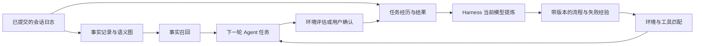

# dsh-advanced-mem-plugin

[English](README.md) | 中文

为 [DeepSeek Harness](https://github.com/deepseek-ai/deepseek-harness) 提供跨会话的**事实记忆与经验记忆**，以 Cordis bundle 形式安装。插件保存用户知识，从已完成任务中提炼可复用流程，并在后续任务中召回适用的经验。同一套经验引擎和评测接口也可通过 TypeScript API 使用。



事实通道回答“关于用户和工作区，已经知道什么”；经验通道回答“这类任务如何完成、需要哪些条件、怎样检查结果”。两个通道采用独立存储、来源规则和召回预算。

## 兼容版本与安装

插件 **0.2.1** 支持 **DeepSeek Harness `dsh-v0.2.1-rc.2`**，官方提交 [`687f282e`](https://github.com/deepseek-ai/deepseek-harness/commit/687f282e8625c6b8d11ff58211a90524be2e4317)。接口变化与验证结果见[兼容性报告](docs/compatibility.zh.md)。使用该 Harness 版本要求的 Node 环境；标准 `web` profile 已提供插件所需的模型、存储与 Agent 服务。

```sh
npm install -g @deepseek-ai/dsh@0.2.1-rc.2
dsh plugin --profile web add github:CenYangtze/dsh-advanced-mem-plugin#master
dsh --profile web --dump-config
dsh web
```

`dsh web` 启动本地 GUI，并自动在浏览器打开包含认证 token 的地址。默认本地地址为 [http://127.0.0.1:3080](http://127.0.0.1:3080)，使用启动器自动打开的标签页即可。在 Harness 中配置模型服务，并在会话中选择模型，经验提炼会复用该模型及 Harness 管理的认证信息。

Git 安装通过 `prepare` 脚本生成 `lib/`。若 pnpm 要求允许构建，在 profile 的 `pnpm-workspace.yaml` 中加入以下配置，再次执行安装：

```yaml
allowBuilds:
  dsh-advanced-mem-plugin: true
```

也可以安装本地构建的发布包：

```sh
pnpm run build
pnpm pack
dsh plugin --profile web add ./dsh-advanced-mem-plugin-0.2.1.tgz
```

默认补丁挂载十个插件。特征哈希嵌入器作为可选入口提供；默认事实检索使用词法排序和图激活。所有 Harness 包均为 peer dependency，从宿主安装中解析。

## 使用事实记忆

事实采集读取已提交的会话事件。用户消息与显式调用的 Skill 可以支持关于用户的知识；助手输出和工具调用作为证据保存，排除在普通召回和用户偏好挖掘之外。

- `memory_search`：在当前作用域链中检索事实知识。
- `memory_write`：保存笔记或有依据的知识。
- `memory_forget` 配合 `mode: "erase"`：删除源记录，并传播到依赖它的经验；默认 `retract` 模式保留历史。
- `/memory`、`/memory search <query>`、`/memory stats`：查看事实记忆。
- `/memory forget <label>`：撤回指定知识，保留审计历史。

语义图保存源记录引用、置信度、支持度、衰减与替代关系。BM25、可选嵌入和图激活使用统一的倒数排名变换。自动事实召回每轮追加一次，并保留 Harness 的请求序列边界。

## 提炼和使用经验

默认的 `extractionMode: harness` 通过 Harness LLM 服务复用当前会话的**模型提供器、模型与认证配置**，无需额外设置经验提炼 API 环境变量。每次提炼都会读取模型选择，GUI 中切换模型后，后续学习随之使用新模型。会话尚未选定模型时，使用 Harness 当前的默认模型。

默认配置在每个已采集任务结束后自动提炼。`/experience learn` 可手动触发提炼，`/experience confirm` 先记录任务结果，再触发学习。这些辅助请求具有独立的输入、输出和超时预算，不携带工具权限。

观察器采集有长度上限的可见动作和结果，覆盖 PTC 嵌套工具调用；不保存原始工具参数或隐藏推理。Harness 一轮结束时，任务结果记录为**未知**。应用评估器可通过 `experience/task-completed` 提交具有验证依据的任务；用户也可确认已采集任务的结果：

```text
/experience list
/experience confirm <episode-id> success
/experience learn
/experience show <skill-id>
/experience export <skill-id>
/experience retract <skill-id>
/experience forget episode <episode-id>
/experience forget skill <skill-id>
/experience forget all
/experience maintain
```

提炼得到结构化流程与失败经验，包含适用情境、前置条件、操作步骤、注意事项、验证方式、所需工具、环境约束和来源任务。Skill 达到配置要求的置信度与独立结果支持后进入活跃状态。仅由模型声明的成功不会直接激活 Skill。

召回选择与当前任务、环境约束、Agent 可用工具相匹配的活跃 Skill，并检查有效期。经验以独立区块每轮注入一次，用于辅助规划；操作执行继续遵循宿主的当前指令、工具权限和审批策略。导出内容是可由 Harness 读取的 `SKILL.md`，包含 YAML 名称与描述、生命周期信息和来源引用。需要将其安装为工作区 Skill 时，可保存到 `.agents/skills/<导出的名称>/SKILL.md`。

### 使用独立的提炼 API

需要为经验提炼单独选择模型时，在 profile 的 `cordis.patch.yml` 中设置 `extractionMode: api`，并在启动 Harness 的终端中配置地址、模型和 key。`DSH_EXPERIENCE_ENDPOINT` 应为兼容 OpenAI 的完整 **chat/completions** 地址。本地无鉴权 API 可将 key 留空。

profile 补丁会替换插件行的**整个 `config`**。可加入以下完整的 `experience-harness` 覆盖配置，并保留已按部署需要调整的参数：

```yaml
- id: experience-harness
  config:
    captureTurns: true
    autoLearn: true
    learnEveryTurns: 1
    maxPendingJobs: 32
    maxRecall: 3
    maxCharacters: 5000
    recallTimeoutMs: 250
    viewLimit: 20
    excludedTools: []
    transportTools: [run_code]
    environment: []
    availableTools: []
    extractionMode: api
    endpointEnv: DSH_EXPERIENCE_ENDPOINT
    modelEnv: DSH_EXPERIENCE_MODEL
    apiKeyEnv: DSH_EXPERIENCE_API_KEY
    temperature: 0
    maxTokens: 4096
    timeoutMs: 60000
    maxResponseBytes: 1048576
    maxExtractionInputChars: 64000
    maxObservationLength: 1000
    promptVersion: experience-v2
```

PowerShell 配置方式：

```powershell
$env:DSH_EXPERIENCE_ENDPOINT = 'https://your-provider.example/v1/chat/completions'
$env:DSH_EXPERIENCE_MODEL = 'your-model'
$env:DSH_EXPERIENCE_API_KEY = 'your-api-key'
dsh web
```

Bash 或 Zsh 配置方式：

```sh
export DSH_EXPERIENCE_ENDPOINT=https://your-provider.example/v1/chat/completions
export DSH_EXPERIENCE_MODEL=your-model
export DSH_EXPERIENCE_API_KEY=your-api-key
dsh web
```

`web` profile 的补丁位于 `$DSH_HOME/profiles/web/cordis.patch.yml`，`DSH_HOME` 默认为 `~/.dsh`。恢复使用会话模型时，在完整配置中将 `extractionMode` 改回 `harness`。独立 TypeScript 提炼提供器继续面向自行指定 API 连接的应用和评测程序。

## 生命周期与部署策略

| 操作 | 持久化行为 |
|---|---|
| 去重 | 为等价流程合并新的支持任务；重复提炼不增加独立证据票数。 |
| 验证 | 将环境评估或用户确认保存为不可变的新经历，保留原先的结果判断。 |
| 反馈 | 接受后续独立任务的使用反馈，更新置信度并隔离反复产生负面结果的 Skill。 |
| 替代 | 激活有证据支持的新版本，保留前序 Skill 与版本历史。 |
| 过期 | 检索时直接过滤过期 Skill，无需等待维护任务运行。 |
| 撤回 | 保存墓碑和审计历史。 |
| 遗忘 | 删除选定内容及其派生 Skill、版本、反馈和后续确认记录。遗忘某 Skill 同时删除其源经历及共享这些经历的其他 Skill；仅停用一个 Skill 时使用撤回。 |
| 容量限制 | 明确拒绝超额写入，通过导出与显式删除回收空间。 |

所有策略值均在 [cordis.patch.yml](cordis.patch.yml) 中显式配置。在 profile 补丁中按 `id` 覆盖插件行时，应先复制对应的完整 `config`，再调整所需参数；这些字段不会与原配置逐项合并。可通过 `environment` 设置 `browser=chromium`、`application=libreoffice-24` 等环境项，本机操作系统自动加入。`availableTools` 可进一步限定 Agent 当前工具注册表。采集与提炼预算、有效期、结果权重和晋升阈值均由部署配置控制。

Harness 存储提供器将每个经验作用域的完整快照写入独立的 `experience` 存储域。独立 API 的 `FileExperienceStore` 使用原子替换和独占写入租约。多租户部署应分配独立 runtime/store 或明确的作用域命名空间。存储和一致性约定见[架构与设计](docs/design.zh.md)。

## 程序接口与评测

```ts
import {
  ExperienceMemory, FileExperienceStore, createOpenAIExperienceDistiller,
} from 'dsh-advanced-mem-plugin/experience/api'
import {
  loadLongMemEval, loadLoCoMo, evaluateDataset,
  createApiAgentFactory, createHarnessMemoryFactory, JsonlCheckpoint,
} from 'dsh-advanced-mem-plugin/evaluation'
```

经验 API 提供 `record`、`learn`、`propose`、`confirmOutcome`、`recall`、`feedback`、`maintain`、`retract`、`forget`、`snapshot` 与 `export`。Harness 内部通过 `ctx.experience.memory` 使用同一引擎。

评测 API 支持 **LongMemEval**、**LoCoMo** 和 **OSWorld**。问答评测按样本隔离作用域，答案标签不进入 Agent 输入；运行保存 manifest、逐样本结果、延迟、token 用量与可恢复检查点。OSWorld 通过 Python HTTP bridge 接入真实 `DesktopEnv` 的 reset/step/evaluate 生命周期，由官方环境评估器产生任务分数。冻结的经验库用于分离经验学习与留出集评测。

[评测使用指南](docs/evaluation.zh.md)提供可执行 API 示例、数据格式、模型配置、指标与 OSWorld 部署说明。评测产物和模型烟测辅助文件应保存在源码树之外；发布包包含正式运行时和适配接口。

## 开发

```sh
# 先按官方说明构建受支持的 Harness checkout。
pnpm install
pnpm run link-harness ../deepseek-harness
pnpm run check
```

`check` 依次运行类型检查、原有回归套件、打包及导出/插件形状验证。验证器分别检查服务插件、函数插件和程序接口模块，构建不会内联 `@deepseek-ai/*` 依赖。

| 目录 | 职责 |
|---|---|
| `src/memory/` | 事实类型、评分、提供器、检索与图生命周期 |
| `src/memory-store-domain/` | 事实记录、节点和边的持久化 |
| `src/memory-observer/`、`src/memory-consolidation/` | 事件采集与事实提炼 |
| `src/memory-recall/`、`src/tool-memory/`、`src/command-memory/` | 事实记忆的模型和用户入口 |
| `src/experience/` | 可移植经验引擎、schema、API 提炼、文件存储和 Skill 导出 |
| `src/experience-store-domain/` | Harness 经验持久化 |
| `src/experience-harness/` | 任务采集、当前模型提炼、召回、命令与生命周期集成 |
| `src/evaluation/` | 数据集读取、API 客户端、运行器、检查点与 OSWorld bridge |
| `bench/` | 原有检索分析工具 |

## 研究依据

[ExpeL](https://arxiv.org/abs/2308.10144)为跨任务提炼可复用知识提供参考；[ReasoningBank](https://arxiv.org/abs/2509.25140)为从已完成轨迹中学习流程与失败经验提供参考。本实现进一步加入明确的结果来源、事实与流程存储分离、版本化生命周期操作和环境适用性匹配。

## 许可证

MIT，见 [LICENSE](LICENSE)。
