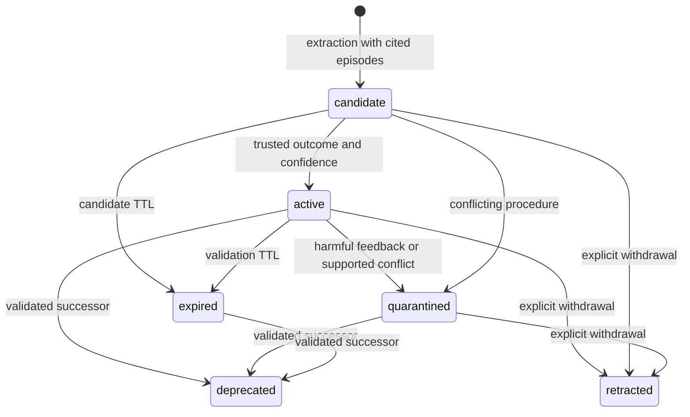

# Architecture and memory lifecycle

English | [中文](design.zh.md)

The plugin provides two memory channels over the same committed task history. Factual memory preserves knowledge about the user and workspace. Experience memory turns observable task attempts into reusable procedures and failure lessons. The host remains responsible for tool execution and authorization.

## Architecture assessment

The original capability split is a useful foundation: a service owns the vocabulary and retrieval policy, providers own persistence and embeddings, observers read committed events, and consumers assemble model or user views. It supports replacing storage and model providers without replacing the agent loop. Three existing decisions remain central:

1. **Source controls use.** Agent actions may contribute evidence but do not become user preferences or raw recalled dialogue. Factual distillation applies the same author filter as factual recall.
2. **Evidence remains addressable.** Layer-1 beliefs cite layer-0 records; records point to session events. A correction can reach both the conclusion and its source.
3. **Ranking is comparable.** Lexical, vector and graph signals use `rankScore`; confidence and support then adjust a common rank scale. The default patch omits feature hashing because it adds no semantic signal.

Task experience needs a separate model of success, failure, applicability and subsequent use. The experience service supplies that model while retaining the existing service/provider boundaries. Its output is a structured skill whose supporting task and verification can be inspected.

## Two channels

| Property | Factual memory | Experience memory |
|---|---|---|
| Question | What is known about this user or workspace? | How can this class of task be completed or a failure avoided? |
| Evidence | Authored messages, notes, artifacts and their provenance | Task, observable action/result pairs, outcome and evaluator evidence |
| Representation | Records, semantic nodes and edges | Episodes, procedures/pitfalls, revisions and feedback |
| Storage | `memory` domain | `experience` domain, or a standalone file store |
| Promotion | Supported user statements or eligible recurrence | Independent trusted outcomes and confidence threshold |
| Recall | Scope chain, lexical/vector/graph retrieval | Explicit scopes, lexical task match, environment and required tools |
| Model surface | Factual block and the existing three memory tools | Compact procedural block and on-demand `experience_inspect` |
| Human surface | `/memory` | `/experience` |

Experience does not write its extracted procedures into the factual graph. A procedure describing an agent's successful use of a tool therefore does not imply that the user prefers that tool. Both channels append context after the current input, once per turn, preserving the stable model prefix and `startsRequestSeries` decision metadata.

## Task capture and multi-turn context

`experience-harness` builds bounded local fragments from committed `session/event` events. Each turn records direct user requests, visible tool results and the last visible assistant summary. Native tool results and nested PTC dispatches share an execution-evidence representation: event identity, sequence, timestamp, call identity, action/check/readback role, execution status and capture completeness. Raw arguments, tool programs and hidden reasoning are excluded. Overlapping mutations and interrupted executions retain their incomplete status; each observation separately records whether its content is complete.

A completed readback with intact tool metadata, complete execution ordering and nonempty text-only content may exceed the local observation budget. Clipping that content preserves `capture.complete`, while its `evidence.complete` remains false. The retained text supplies background and cannot support any assessment criterion. Tool-side truncation does not qualify for this exception. Final confirmation still requires complete, fresh checks or readbacks after the last possible state change.

Task boundaries follow the evolving user objective. A separate model call merges the latest original request with the preceding checkpoint and a bounded chain of earlier requests. Its strict output contains only the consolidated `task` and a `continuation` or `increment` classification. It preserves unwithdrawn requirements, applies corrections and additions, and interprets stage-specific instructions such as planning before implementation. Original user requests govern the result: the model corrects unsupported conditions in prior summaries and assessment criteria, and separates required results from explicitly requested methods. Reading and verifying an artifact and running an existing validation script does not itself require adding each condition as an assertion in that script. Model classification never assigns an outcome.

Every `taskContext` records the session identity, monotonically increasing revision, original `latestRequest` and predecessor episode. The latest durable checkpoint restores this context after restart. Planning rounds also create checkpoints, while automatic skill extraction waits for tool work. Confirmation episodes retain the same task revision through `derivedFrom`.

The host also records `currentEvidenceStartSeq`, the committed event boundary of the current turn. The evaluator uses it to distinguish inherited actions from current work: a restriction scoped to this turn applies to current events, while persistent restrictions apply across the available task history. A new confirmation must cite verification from the current turn.

Pending work carries relevant prior steps into the next checkpoint. A successful baseline contributes its cited verification steps; a user or external evaluator receipt remains acceptance context without being converted into a tool check. Current steps follow the baseline, committed events are deduplicated, and current recalled skill versions take precedence. The episode cites current source events and retained step evidence; older requests remain accessible through the predecessor chain.

Step budgets retain recent work and mark incomplete projections. A later complete execution with fresh final verification can reassess the current artifact. `priorCaptureIncomplete` preserves historical gaps through subsequent revisions: new artifact checks do not establish compliance with earlier process restrictions whose execution record is missing. Composition failures retain the request and lineage with an unknown outcome, making later clarification and revalidation possible.

## Outcome assessment and pending work

Captured turns initially have unknown outcomes. With `autoConfirm` enabled, the runtime first checks whether complete execution evidence and final verification are available. A separate model then enumerates the material requirements and quotes exact observations supporting each passed or failed criterion. The request excludes the assistant's completion summary as evidence.

The runtime checks quoted text against committed event IDs, restricts final proof to complete checks/readbacks after the last possible state change, requires coverage of every material requirement, and applies `minOutcomeConfidence`. Each continuation or increment needs fresh verification beyond its predecessor. Accepted assessments become `tool-evidence` outcomes: all requirements passing yields success, verified passing and failing requirements yield partial, and verified failures yield failure. Unsupported requirements remain unknown.

Line numbers appear only in auxiliary assessment requests and responses: an event ID plus a 1-based inclusive line range resolves to an exact original quotation for the existing evidence gates and ledger, preserving source newlines and the compact source counts used in ordinary recall.

The evidence ledger records the assessor, criteria, exact quotations and the actual verification time. Repeated assessment of the same execution evidence adds no independent task and does not refresh its validation age. External evaluators can submit a `verified` task through:

```ts
await ctx.parallel('experience/task-completed', episode)
```

`/experience pending` exposes unresolved tasks and their reasons. `/experience assess <episode-id>` asks the configured model to reassess the existing evidence. Complete captures whose assessment failed because of a service or response-parsing error can be retried during maintenance, bounded by `maxReassessmentsPerMaintenance`; substantive model uncertainty does not enter this retry loop. Users can continue with a fresh check or use `/experience confirm <episode-id> success|failure|partial` after checking the result. Explicit confirmation persists a user-authored evidence note and appends an immutable confirmation episode. Multiple turns or confirmations from one session do not manufacture independent support.

## Model-backed extraction

Requirement consolidation, outcome assessment and skill extraction share a bounded auxiliary-model interface with separate prompt identities. The default `inherit` selection uses the host's `llm` service, resolving the session's next selection, last request, agent configuration and host default in that order. Each request has no tools and does not add a conversation turn. Provider authentication remains inside Harness.

The plugin GUI can keep `inherit`, select another configured Harness provider/model with `harness`, or use an independent OpenAI-compatible endpoint with `api`. Saved settings apply to later auxiliary requests. API credentials travel through the host credential service; configuration retains a credential reference, resolved at request time. Explicit environment-based `extractionMode: api` deployments remain available through the inherited configuration. The portable API keeps the same HTTP extraction provider.

Both distillers receive bounded task episodes and relevant existing skills. Their versioned identity records the model and extraction prompt version. The prompt asks for transferable procedures and pitfalls, parameterized incidental details, explicit applicability and observable verification. Success and failure evidence may be compared within the selected batch, following the task-experience approach in [ExpeL](https://arxiv.org/abs/2308.10144) and [ReasoningBank](https://arxiv.org/abs/2509.25140).

Extraction exposes short episode aliases local to the current batch and a whitelist of citable aliases. Existing skills contribute reusable content and replacement identities. The adapter resolves each proposed alias to its durable source ID before the core checks provenance. Pending extraction remains durable after service or format failures and receives bounded maintenance retries.

The runtime parses a strict JSON schema and checks scope-local episode citations before accepting proposals. A second check after the model call rejects evidence deleted or changed while extraction was running. Extraction never modifies model weights or requests hidden chain-of-thought. Timeouts, response limits, input budgets and candidate counts are explicit configuration. The Harness stream must finish successfully; truncated, aborted and tool-calling responses are rejected. Cancellation propagates through the host adapter, including plugin shutdown.

## Skill lifecycle



**Deduplication.** Equivalent procedure content and context merge supporting episode identities. Across independent tasks, near-duplicate matching also requires matching procedure and verification steps. Rewording a highly similar lesson from the same task retains the established instructions. A newly trusted outcome permits one audited reassessment of the extraction confidence; repeated extraction of the same evidence adds no votes. Retired instructions are not automatically recreated by ordinary duplicate extraction.

**Validation and confidence.** Procedure support comes from successful tasks; pitfall support comes from failed or partial tasks. External verification, accepted tool-evidence assessments and user confirmations have explicit source weights. Model confidence is weighted by that evidence; model-only success claims do not activate a procedure. Automatic feedback identifies the exact recalled skill version, quotes actions demonstrating its application, and cites relevant final verification from a later independent task. Retrieval or an overall task score alone does not supply attribution. Duplicate feedback is rejected or handled idempotently.

**Versioning and conflicts.** A changed skill creates a revision. Explicit `supersedes` links retain the old procedure until the replacement is validated. A conflicting proposal with the same title and context is quarantined for review. Quarantining the established procedure additionally requires independent trusted task evidence; another interpretation of the same task cannot withdraw it. Replacement and retraction are visible lifecycle operations.

**Expiry.** An active skill's validity is tied to its last trusted evidence. Candidate validity is tied to its creation time. Retrieval checks expiry directly; maintenance persists state transitions. Ordinary duplicate extraction does not revive expired or quarantined procedures.

**Capacity.** Episode and skill limits are hard admission limits. Reaching a limit returns an explicit capacity error. Export and deliberate `forget` reclaim space; silent eviction does not destroy the audit trail.

**Erasure.** Experience `forget` computes the dependency closure across source episodes, task-checkpoint and confirmation descendants, dependent skills, replacement descendants, feedback and historical revisions, then commits one updated scope snapshot. Forgetting a skill also erases its source and feedback episodes, including other skills derived from that shared evidence; use `retract` to withdraw one skill while retaining its sources. Factual erasure awaits experience cleanup through `memory/before-forget`. It also invalidates the current capture projection, so the turn cannot recreate already-erased material when it ends. Source session logs and externally exported files have their own retention controls; the memory API operates on its owned stores.

## Retrieval and execution

A query supplies explicit scopes, current environment and available tools. Only active skills within their validity interval and matching every environment constraint are considered. Missing environment values do not satisfy a constraint. The Harness adapter checks the current agent's tool registry, including tools exposed through PTC.

BM25 supplies task relevance; `rankScore` and confidence determine the score. Duplicate recall is suppressed and complete procedures fit a separate character budget. Automatic recall includes applicability, prerequisites, steps, verification and compact source counts. It leaves trajectory expansion on demand.

`experience_inspect` provides `skill`, `sources` and `verification` views in the current scope. The source index groups task revisions and confirmations by session, with outcome, timestamp, lineage and evidence counts. Verification expansion requires an episode belonging to that skill and returns assessed criterion quotations or the explicit confirmation references. Pagination and character budgets bound each response. `/experience sources` provides the same index to the user; ordinary recall does not replay raw tool histories.

Environment tags should identify the properties that affect execution: operating system, application version, browser family or workflow variant. A skill valid for one version can remain available for that version while a validated successor targets another. Recalled content has advisory authority; tool authorization remains with the host.

## Persistence and concurrency

The experience engine serializes mutations per scope. Every mutation reads, validates and commits a complete scope snapshot. API extraction runs outside the mutation queue and rechecks provenance before committing. Record and feedback identities make retries idempotent and reject identity reuse with different content.

The Harness provider uses a separate storage domain and inherits the profile's backend routing. The standalone file provider hashes scope names into filenames, writes a temporary file, flushes it and atomically replaces the snapshot. An exclusive writer lease prevents two processes from silently overwriting each other's read-modify-write cycles. Close the store after outstanding operations finish. After a process crash, verify the recorded owner has exited before removing its stale lease.

Capture, composition, assessment and extraction jobs are serialized and bounded; a failing background write is logged without blocking the agent turn. Maintenance runs after task recording, on user inspection, and at the configured interval over a bounded set of recently used scopes. Automatic feedback and maintenance use the same mutation queue. Recall has its own deadline and can omit unavailable experience context while preserving the host decision. Scope keys are caller-controlled partitions; deployments provide tenant-specific runtimes or prefixes.

## Evaluation boundary

The [evaluation API](evaluation.md) invokes the same memory engine used in production. QA adapters pass history and the question to the agent; references and evidence annotations stay with the evaluator. Each attempt receives a fresh namespace, including retries. Manifests bind dataset identity, implementation, model, memory, judge, sample order and execution settings to a checkpoint.

Experience experiments freeze a provenance-complete training bank before held-out evaluation. Source task identities, full-history identities and per-session content fingerprints are checked for overlap, including renamed sessions shared between different history collections. OSWorld actions run against the actual environment, and its evaluator produces the task score after execution. The runner saves trajectories and metrics without adding evaluation labels to production memory.
