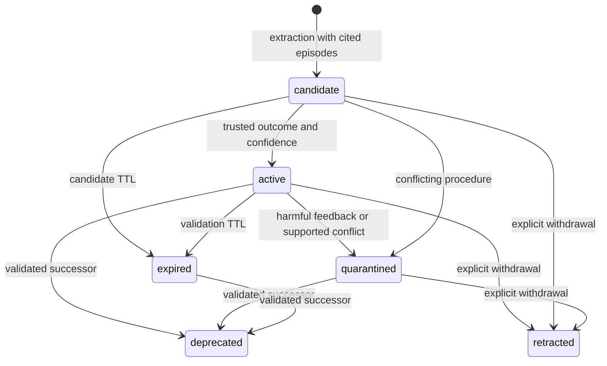

# Architecture and memory lifecycle

English | [中文](design.zh.md)

The plugin provides two memory channels over the same committed task history. Factual memory preserves knowledge about the user and workspace. Experience memory turns observable task attempts into reusable procedures and failure lessons. The host remains responsible for tool execution and authorization.

## Architecture assessment

The original capability split is a useful foundation: a service owns the vocabulary and retrieval policy, providers own persistence and embeddings, observers read committed events, and consumers assemble model or user views. It supports replacing storage and model providers without replacing the agent loop. Three existing decisions remain central:

1. **Source controls use.** Agent actions may contribute evidence but do not become user preferences or raw recalled dialogue. Factual distillation applies the same author filter as factual recall.
2. **Evidence remains addressable.** Layer-1 beliefs cite layer-0 records; records point to session events. A correction can reach both the conclusion and its source.
3. **Ranking is comparable.** Lexical, vector and graph signals use `rankScore`; confidence and support then adjust a common rank scale. The default patch omits feature hashing because it adds no semantic signal.

Task experience needs a separate model of success, failure, applicability and subsequent use. The experience service supplies that model while retaining the existing service/provider boundaries. Its output is a structured skill whose supporting task and verification can be inspected.

## Two channels

| Property | Factual memory | Experience memory |
|---|---|---|
| Question | What is known about this user or workspace? | How can this class of task be completed or a failure avoided? |
| Evidence | Authored messages, notes, artifacts and their provenance | Task, observable action/result pairs, outcome and evaluator evidence |
| Representation | Records, semantic nodes and edges | Episodes, procedures/pitfalls, revisions and feedback |
| Storage | `memory` domain | `experience` domain, or a standalone file store |
| Promotion | Supported user statements or eligible recurrence | Independent trusted outcomes and confidence threshold |
| Recall | Scope chain, lexical/vector/graph retrieval | Explicit scopes, lexical task match, environment and required tools |
| Model surface | Factual block and the existing three memory tools | Separate procedural block, containing complete skills |
| Human surface | `/memory` | `/experience` |

Experience does not write its extracted procedures into the factual graph. A procedure describing an agent's successful use of a tool therefore does not imply that the user prefers that tool. Both channels append context after the current input, once per turn, preserving the stable model prefix and `startsRequestSeries` decision metadata.

## Task capture and outcomes

`experience-harness` maintains a bounded projection of `session/event`. It begins at `turn/start`, records direct task text, visible tool results and the last visible assistant summary, and commits at `turn/end`. Native `tool/result` and nested `tool/ptc-dispatch` use the same action/result representation. Raw arguments, tool-call programs, hidden reasoning and binary attachments are excluded. Each retained observation cites its session event.

A turn boundary describes execution state. It does not establish that the user's task succeeded. Automatically captured episodes therefore use `unknown` outcomes. A host can submit a multi-turn task with a verified result through:

```ts
await ctx.parallel('experience/task-completed', episode)
```

The supplied `ExperienceEpisodeInput` has a stable id, scope, task, summary, bounded steps, environment, source references, timestamps and an outcome. `verified` outcomes cite an evaluator or executed check; `user` outcomes cite an explicit confirmation. `model` and `unknown` outcomes retain their lower evidentiary status. The caller owns the evaluator's authenticity; the schema validates the representation and evidence references.

`confirmOutcome` appends an immutable confirmation episode linked by `derivedFrom`. Assessment uses the newest result in that task family. Multiple confirmations of one task, and multiple attempts in one session, do not manufacture independent support.

## Model-backed extraction

Harness extraction uses the host's `llm` service by default. Each extraction resolves the session's next model selection, including a pending GUI change, followed by the last request, the agent configuration and the host default. Provider authentication remains inside Harness. Extraction runs as an auxiliary model call with no tools and does not add a conversation turn. The explicit `api` mode and the portable API retain the OpenAI-compatible HTTP distiller.

Both distillers receive bounded task episodes and relevant existing skills. Their versioned identity records the model and extraction prompt version. The prompt asks for transferable procedures and pitfalls, parameterized incidental details, explicit applicability and observable verification. Success and failure evidence may be compared within the selected batch, following the task-experience approach in [ExpeL](https://arxiv.org/abs/2308.10144) and [ReasoningBank](https://arxiv.org/abs/2509.25140).

The runtime parses a strict JSON schema and checks scope-local episode citations before accepting proposals. A second check after the model call rejects evidence deleted or changed while extraction was running. Extraction never modifies model weights or requests hidden chain-of-thought. Timeouts, response limits, input budgets and candidate counts are explicit configuration. The Harness stream must finish successfully; truncated, aborted and tool-calling responses are rejected. Cancellation propagates through the host adapter, including plugin shutdown.

## Skill lifecycle



**Deduplication.** Equivalent procedure content and context merge supporting episode identities. Across independent tasks, near-duplicate matching also requires matching procedure and verification steps. Rewording a highly similar lesson from the same task retains the established instructions. A newly trusted outcome permits one audited reassessment of the extraction confidence; repeated extraction of the same evidence adds no votes. Retired instructions are not automatically recreated by ordinary duplicate extraction.

**Validation and confidence.** Procedure support comes from successful tasks; pitfall support comes from failed or partial tasks. Verified and user-confirmed outcomes may count toward independent support. Model confidence is weighted by outcome evidence; later helpful and harmful feedback changes confidence. Feedback must cite a later independent task in a compatible environment. Repeated feedback for the same task is rejected or handled idempotently.

**Versioning and conflicts.** A changed skill creates a revision. Explicit `supersedes` links retain the old procedure until the replacement is validated. A conflicting proposal with the same title and context is quarantined for review. Quarantining the established procedure additionally requires independent trusted task evidence; another interpretation of the same task cannot withdraw it. Replacement and retraction are visible lifecycle operations.

**Expiry.** An active skill's validity is tied to its last trusted evidence. Candidate validity is tied to its creation time. Retrieval checks expiry directly; maintenance persists state transitions. Ordinary duplicate extraction does not revive expired or quarantined procedures.

**Capacity.** Episode and skill limits are hard admission limits. Reaching a limit returns an explicit capacity error. Export and deliberate `forget` reclaim space; silent eviction does not destroy the audit trail.

**Erasure.** Experience `forget` computes the dependency closure across source episodes, confirmation descendants, dependent skills, replacement descendants, feedback and historical revisions, then commits one updated scope snapshot. Forgetting a skill also erases its source and feedback episodes, including other skills derived from that shared evidence; use `retract` to withdraw one skill while retaining its sources. Factual erasure awaits experience cleanup through `memory/before-forget`. It also invalidates the current capture projection, so the turn cannot recreate already-erased material when it ends. Source session logs and externally exported files have their own retention controls; the memory API operates on its owned stores.

## Retrieval and execution

A query supplies explicit scopes, current environment and available tools. Only active skills within their validity interval and matching every environment constraint are considered. Missing environment values do not satisfy a constraint. The Harness adapter checks the current agent's tool registry, including tools exposed through PTC.

BM25 supplies task relevance; `rankScore` and confidence determine the score. Duplicate recall is suppressed and whole skills are fitted into a separate character budget. The model sees applicability, prerequisites, procedure, verification and source references. It never receives a raw stored trajectory through experience recall.

Environment tags should identify the properties that affect execution: operating system, application version, browser family or workflow variant. A skill valid for one version can remain available for that version while a validated successor targets another. Recalled content has advisory authority; tool authorization remains with the host.

## Persistence and concurrency

The experience engine serializes mutations per scope. Every mutation reads, validates and commits a complete scope snapshot. API extraction runs outside the mutation queue and rechecks provenance before committing. Record and feedback identities make retries idempotent and reject identity reuse with different content.

The Harness provider uses a separate storage domain and inherits the profile's backend routing. The standalone file provider hashes scope names into filenames, writes a temporary file, flushes it and atomically replaces the snapshot. An exclusive writer lease prevents two processes from silently overwriting each other's read-modify-write cycles. Close the store after outstanding operations finish. After a process crash, verify the recorded owner has exited before removing its stale lease.

Capture and extraction jobs are serialized and bounded; a failing background write is logged without blocking the agent turn. Recall has its own deadline and can omit unavailable experience context while preserving the host decision. Scope keys are caller-controlled partitions; deployments provide tenant-specific runtimes or prefixes.

## Evaluation boundary

The [evaluation API](evaluation.md) invokes the same memory engine used in production. QA adapters pass history and the question to the agent; references and evidence annotations stay with the evaluator. Each attempt receives a fresh namespace, including retries. Manifests bind dataset identity, implementation, model, memory, judge, sample order and execution settings to a checkpoint.

Experience experiments freeze a provenance-complete training bank before held-out evaluation. Source task identities and conversation fingerprints are checked for overlap. OSWorld actions run against the actual environment, and its evaluator produces the task score after execution. The runner saves trajectories and metrics without adding evaluation labels to production memory.
