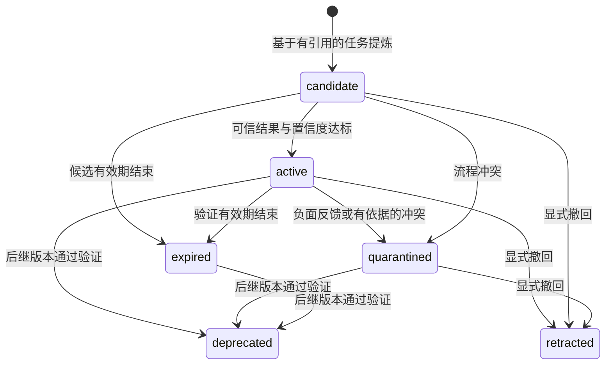

# 架构与记忆生命周期

[English](design.md) | 中文

插件在同一份已提交任务历史上提供两个记忆通道。事实记忆保存关于用户和工作区的知识；经验记忆将可观察的任务尝试转化为可复用流程与失败经验。工具执行及其授权由宿主负责。

## 架构分析

原有能力分层为扩展提供了合适的基础：服务定义类型和检索策略，提供器负责持久化与嵌入，观察器读取已提交事件，消费端组织模型或用户视图。这使存储和模型提供器可以独立替换，保留 Agent 主循环。以下三项设计继续作为系统基础：

1. **来源决定用途。** Agent 行为可以贡献证据，但不会变成用户偏好或原始对话回放。事实提炼和事实召回遵循同一作者过滤规则。
2. **证据可寻址。** Layer-1 知识引用 Layer-0 记录，记录定位到会话事件，使修正能同时触及结论与来源。
3. **评分可比较。** 词法、向量与图信号统一使用 `rankScore`，再由置信度和支持度调整。默认配置不挂载缺乏语义信号的特征哈希嵌入器。

任务经验需要表示成功、失败、适用条件和后续使用结果。经验服务补充这套语义，并沿用已有服务与提供器边界。输出的结构化 Skill 可以追溯到支持任务及其验证依据。

## 两个通道

| 属性 | 事实记忆 | 经验记忆 |
|---|---|---|
| 回答的问题 | 关于用户或工作区，已经知道什么？ | 如何完成这类任务，或避免某类失败？ |
| 依据 | 有作者来源的消息、笔记、产物及溯源 | 任务、可观察的动作与结果、任务结局、评估依据 |
| 表示 | 记录、语义节点与关系边 | 任务经历、流程/失败经验、修订与反馈 |
| 存储 | `memory` 域 | `experience` 域，或独立文件存储 |
| 晋升 | 有支持的用户陈述或符合条件的重复行为 | 独立可信结果与置信度阈值 |
| 召回 | 作用域链、词法/向量/图检索 | 显式作用域、任务相关性、环境与所需工具 |
| 模型入口 | 事实区块与既有三个记忆工具 | 精简流程区块与按需 `experience_inspect` |
| 用户入口 | `/memory` | `/experience` |

经验服务不会将提炼出的流程写进事实图。Agent 成功使用某工具的经验不会被解释为用户对该工具的偏好。两个通道均在当前输入之后每轮追加一次上下文，保留稳定的模型前缀和 `startsRequestSeries` 决策元数据。

## 任务采集与多轮上下文

`experience-harness` 从已提交的 `session/event` 构造有界的本轮片段，记录用户直接请求、可见工具结果与最后一段可见助手总结。原生工具结果与 PTC 嵌套调用使用统一执行证据：事件身份、序号、时间戳、调用身份、动作/检查/回读类别、执行状态与采集完整性。原始参数、工具程序和隐藏推理不进入经历；并行修改与执行中断保留其不完整状态，每条观察另行记录内容是否完整。

已完成、工具元数据与执行时序完整、内容为非空纯文本的回读，可能超过本地观察长度预算。裁剪这类内容时保留 `capture.complete`，该条观察的 `evidence.complete` 仍为 false。保留的文字只提供背景，不能支持任何评估条件；工具本身的输出截断不适用这一例外。最终确认仍需引用最后一次可能改变状态的操作之后的完整新检查或回读。

任务边界随用户目标演进。独立模型调用将最新原始请求与前一检查点、预算内的历史原始请求合并，严格输出合并后的 `task` 以及 `continuation` 或 `increment` 分类。合并保留未撤销要求，处理更正与新增内容，并解释先规划后实施等阶段性指令。合并结果以用户原始请求为准，修正旧摘要和评估条件中缺乏原始依据的附加要求，并区分结果要求与用户明确指定的方法。读取核验产物并运行已有验证脚本，本身不要求将每项条件新增为该脚本中的断言。该分类不赋予任务成功或失败结果。

每个 `taskContext` 保存会话身份、递增修订号、原始 `latestRequest` 与前驱经历。重启后从最新持久检查点恢复上下文。纯规划轮同样保存检查点，自动 Skill 提炼则等待工具工作；通过 `derivedFrom` 追加的结果确认保持原任务修订号。

宿主还记录本轮已提交事件的边界 `currentEvidenceStartSeq`，让评估模型区分继承的历史操作与当前执行。仅针对本轮的限制作用于当前事件，持续性限制则覆盖可用的任务历史。新的结果确认必须引用本轮验证。

待完成任务将相关步骤带入下一检查点。成功基线保留其引用的验证步骤；用户确认或外部评估回执作为验收背景，不会被改写成工具检查。本轮步骤接在基线之后，按已提交事件去重，本轮实际召回的 Skill 版本优先。新经历引用本轮来源与保留步骤的证据，较早请求通过前驱链访问。

步数预算保留近期工作，并标记不完整投影。后续完整执行和新的最终验证可以重新验收当前产物。`priorCaptureIncomplete` 在后续修订中保留历史缺口：新的产物检查不证明依赖缺失旧执行记录的过程限制已经遵守。合并失败时保留原请求和前驱关系，结果保持未知，后续仍可通过澄清和重验推进。

## 结果评估与待确认任务

采集结果最初为未知。启用 `autoConfirm` 后，运行时先检查执行证据与最终验证是否完整，再由独立模型枚举实质要求，并为通过或失败的条件引用观察原文。评估请求不将助手完成总结作为证据。

运行时将引用文本与已提交事件 ID 核对，要求最终依据来自最后一次可能改变状态的动作之后的完整检查或回读，并核验实质要求覆盖和 `minOutcomeConfidence`。每个延续或增量检查点都需要晚于前驱的新验证。通过校验的评估形成 `tool-evidence` 结果：全部要求通过为成功，有已验证的通过项和失败项为部分完成，存在已验证失败项且无通过项为失败；缺少支持的要求保持未知。

行号仅用于辅助评估请求与响应：运行时根据事件 ID 和从 1 开始、含两端的行范围还原原文，保留原始换行并继续执行既有证据校验与账本记录，普通召回保持精简来源计数。

证据账本保存评估器、条件、准确引用与实际验证时间。重复评估同一执行证据不会增加独立任务或刷新验证年龄。外部评估器可以提交 `verified` 任务：

```ts
await ctx.parallel('experience/task-completed', episode)
```

`/experience pending` 展示待确认任务与原因。`/experience assess <episode-id>` 请求配置的模型重审已有证据。采集完整、因服务或响应解析异常而评估失败的任务可在维护时重试，每轮数量受 `maxReassessmentsPerMaintenance` 约束；模型对任务的实质性不确定判断不进入该重试循环。用户可以继续任务并执行新检查，或核验结果后使用 `/experience confirm <episode-id> success|failure|partial`。显式确认保存用户来源的证据笔记，并追加不可变确认经历。同一会话中的多轮任务或多次确认不会制造额外独立支持。

## 模型驱动的经验提炼

要求合并、结果评估和 Skill 提炼共用有预算限制的辅助模型接口，各自拥有独立提示版本。默认 `inherit` 选择使用宿主 `llm` 服务，依次解析会话下一次请求的模型、最近请求、Agent 配置和宿主默认模型。每次请求不携带工具，也不增加对话回合；提供商认证由 Harness 管理。

插件 GUI 可保持 `inherit`，通过 `harness` 指定另一组已配置的提供商与模型，或通过 `api` 使用独立 OpenAI 兼容接口。保存后的选择应用于后续辅助请求。API 密钥通过宿主凭据服务处理，配置保存凭据引用并在请求时解析。已有显式 `extractionMode: api` 环境变量部署继续通过继承配置使用；可移植 API 保留同一 HTTP 提炼提供器。

两种提炼器均接收有预算限制的任务经历和相关既有 Skill，其版本化身份记录模型与提炼提示版本。提示要求提炼可迁移流程和失败经验、参数化偶然细节、写明适用条件与可观察的验证方式。同一批次可以比较成功和失败依据，参考 [ExpeL](https://arxiv.org/abs/2308.10144) 与 [ReasoningBank](https://arxiv.org/abs/2509.25140) 的任务经验学习思路。

提炼输入为当前批次分配简短的经历编号，并明确允许引用的编号集合。既有 Skill 提供可复用内容与替代标识。适配器将候选中的局部编号解析回持久来源 ID，再由核心核验出处。服务或格式异常发生后，待提炼经历继续保留，并通过有数量上限的维护重试恢复处理。

运行时解析严格 JSON schema，核对同一作用域中的任务引用后才接受候选。模型调用返回后再次核验来源，拒绝提炼期间已被删除或改动的依据。提炼不修改模型参数，也不请求隐藏思维链。超时、响应大小、输入预算和候选数量均显式配置。Harness 流必须成功结束；截断、中止或请求工具的输出不会入库。取消信号通过宿主适配器传递，插件关闭时也会取消提炼。

## Skill 生命周期



**去重。** 内容与环境等价的流程合并支持任务 ID。来自独立任务的近似去重要求操作步骤和验证步骤一致；同一任务中高度相似的流程改写则保留已建立的操作步骤。新可信结果允许一次有审计记录的提炼置信度重评，重复提炼同一依据不增加证据票数。常规重复提炼不会自动重新创建已撤回的流程。

**验证与置信度。** 流程的支持来自成功任务，失败经验的支持来自失败或部分完成任务。外部验证、通过运行时校验的工具证据评估和用户确认分别采用显式来源权重。提炼置信度按该证据加权，仅由模型声明的成功不激活流程。自动反馈定位准确的召回 Skill 版本，引用证明其实际应用的动作，并引用后续独立任务中相关的最终验证。检索命中或任务整体分数不足以建立归因；重复反馈被拒绝或按幂等请求处理。

**版本与冲突。** Skill 变化产生修订记录。显式 `supersedes` 连接替代关系，在新版本通过验证前保留原流程。同名且环境相同的冲突提案进入隔离状态，供核对处理；隔离既有流程还需要独立可信任务依据，同一任务的另一种解释不会撤销已建立的流程。替代与撤回均为可见的生命周期操作。

**过期。** 活跃 Skill 的有效期绑定最后一次可信依据，候选有效期绑定创建时间。检索直接检查有效期，维护操作持久化状态转换。常规重复提炼不会重新激活过期或隔离流程。

**容量。** 任务与 Skill 数量采用硬性准入上限。达到上限时返回明确容量错误，通过导出和显式 `forget` 回收空间，保留可解释的审计历史。

**删除。** 经验 `forget` 计算源经历、后续任务检查点与确认、派生 Skill、后继版本、反馈和历史修订的依赖闭包，再以一个作用域快照提交。遗忘 Skill 时一并删除其来源和反馈经历，以及共享这些依据的其他 Skill；仅撤回一个 Skill 并保留依据时使用 `retract`。事实删除通过 `memory/before-forget` 等待经验清理，同时使当前采集投影失效，防止回合结束时重新保存已删除内容。原始会话日志和外部导出文件各自遵循其存储方的保留策略；记忆 API 管理其所属存储。

## 召回与执行

查询显式提供作用域、当前环境和可用工具。候选必须处于活跃状态、仍在有效期内，并满足全部环境约束；缺失的环境值不会视为匹配。Harness 适配器检查当前 Agent 的工具注册表，覆盖通过 PTC 暴露的工具。

BM25 衡量任务相关性，`rankScore` 和置信度决定最终评分。召回去除重复结果，将完整流程放入独立字符预算。自动注入包含适用情境、前置条件、步骤、验证方式和精简来源计数，轨迹来源按需展开。

`experience_inspect` 在当前作用域提供 `skill`、`sources` 和 `verification` 视图。来源索引按会话组织任务修订与确认，包含结果、时间、前驱关系和证据计数。展开验证时必须指定属于该 Skill 的经历，返回已评估条件的引用原文或明确确认的来源引用。分页与字符预算约束单次响应。用户通过 `/experience sources` 查看同一索引；常规召回不回放原始工具历史。

环境标签应描述影响执行的属性，例如操作系统、应用版本、浏览器类别和流程变体。旧版本环境的 Skill 可继续服务对应环境，新验证版本适配另一环境。召回内容用于辅助决策，工具执行权限由宿主控制。

## 持久化与并发

经验引擎按作用域串行修改。每次操作读取、校验并提交完整作用域快照。API 提炼在修改队列之外执行，提交前重新核验来源。记录和反馈 ID 支持幂等重试；同一 ID 携带不同内容会被拒绝。

Harness 提供器使用独立存储域并继承 profile 的后端路由。独立文件提供器将作用域映射为哈希文件名，经临时文件写入、刷盘和原子替换提交快照。独占写租约阻止多个进程静默覆盖彼此的读改写结果。调用方应在操作结束后关闭存储；进程崩溃后，确认记录的持有者已退出再清理残留租约。

采集、要求合并、结果评估与提炼任务串行处理并限制排队数量；后台写入失败会记录日志，不阻塞 Agent 回合。维护在任务记录后、用户查看时，以及配置周期内针对预算范围内近期使用的作用域执行。自动反馈与维护使用同一修改队列。召回具有独立截止时间，经验不可用时保留宿主原有决策。作用域键由调用方管理，多租户部署使用独立 runtime 或命名空间前缀。

## 评测边界

[评测 API](evaluation.zh.md) 使用生产中的同一记忆引擎。问答适配器将历史与问题传给 Agent，将参考答案和证据标注留在评估端。每次尝试，包括重试，都分配新的命名空间。Manifest 将数据集身份、实现、模型、记忆、评分器、样本顺序和执行配置绑定到检查点。

经验评测在留出集运行前冻结具有完整来源的训练经验库，并检查源任务 ID、完整历史身份和单会话内容指纹是否重叠，包括不同历史集合中重新编号的共享会话。OSWorld 动作在真实环境执行，结束后由官方评估器产生任务分数。运行器保存轨迹与指标，评测标签不会被加入生产记忆。
