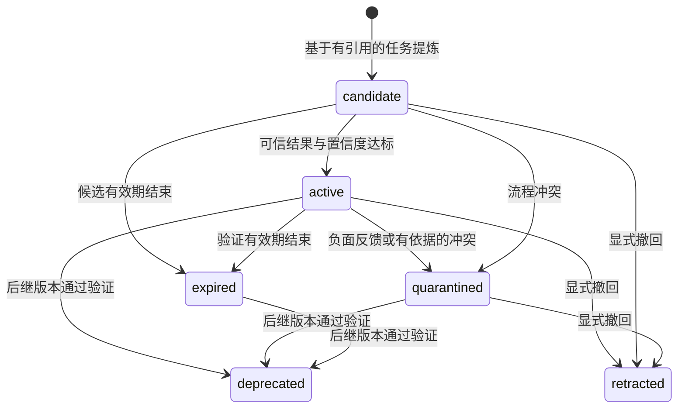

# 架构与记忆生命周期

[English](design.md) | 中文

插件在同一份已提交任务历史上提供两个记忆通道。事实记忆保存关于用户和工作区的知识；经验记忆将可观察的任务尝试转化为可复用流程与失败经验。工具执行及其授权由宿主负责。

## 架构分析

原有能力分层为扩展提供了合适的基础：服务定义类型和检索策略，提供器负责持久化与嵌入，观察器读取已提交事件，消费端组织模型或用户视图。这使存储和模型提供器可以独立替换，保留 Agent 主循环。以下三项设计继续作为系统基础：

1. **来源决定用途。** Agent 行为可以贡献证据，但不会变成用户偏好或原始对话回放。事实提炼和事实召回遵循同一作者过滤规则。
2. **证据可寻址。** Layer-1 知识引用 Layer-0 记录，记录定位到会话事件，使修正能同时触及结论与来源。
3. **评分可比较。** 词法、向量与图信号统一使用 `rankScore`，再由置信度和支持度调整。默认配置不挂载缺乏语义信号的特征哈希嵌入器。

任务经验需要表示成功、失败、适用条件和后续使用结果。经验服务补充这套语义，并沿用已有服务与提供器边界。输出的结构化 Skill 可以追溯到支持任务及其验证依据。

## 两个通道

| 属性 | 事实记忆 | 经验记忆 |
|---|---|---|
| 回答的问题 | 关于用户或工作区，已经知道什么？ | 如何完成这类任务，或避免某类失败？ |
| 依据 | 有作者来源的消息、笔记、产物及溯源 | 任务、可观察的动作与结果、任务结局、评估依据 |
| 表示 | 记录、语义节点与关系边 | 任务经历、流程/失败经验、修订与反馈 |
| 存储 | `memory` 域 | `experience` 域，或独立文件存储 |
| 晋升 | 有支持的用户陈述或符合条件的重复行为 | 独立可信结果与置信度阈值 |
| 召回 | 作用域链、词法/向量/图检索 | 显式作用域、任务相关性、环境与所需工具 |
| 模型入口 | 事实区块与既有三个记忆工具 | 独立经验区块，按完整 Skill 注入 |
| 用户入口 | `/memory` | `/experience` |

经验服务不会将提炼出的流程写进事实图。Agent 成功使用某工具的经验不会被解释为用户对该工具的偏好。两个通道均在当前输入之后每轮追加一次上下文，保留稳定的模型前缀和 `startsRequestSeries` 决策元数据。

## 任务采集与结果来源

`experience-harness` 对 `session/event` 维护有界投影：从 `turn/start` 开始，保存直接任务文本、可见工具结果和最后一段可见助手总结，在 `turn/end` 提交。原生 `tool/result` 和嵌套 `tool/ptc-dispatch` 统一表示为动作与观察。原始参数及参数中的程序、隐藏推理和二进制附件不进入经历；保留的观察引用其会话事件。

回合边界描述执行状态，任务是否成功需要结果依据。因此自动采集经历采用 `unknown` 结果。宿主也可通过以下入口提交具有验证结果的多轮任务：

```ts
await ctx.parallel('experience/task-completed', episode)
```

`ExperienceEpisodeInput` 包含稳定 ID、作用域、任务、总结、有界步骤、环境、源引用、时间戳和结果。`verified` 结果引用评估器或已执行检查，`user` 结果引用明确确认；`model` 和 `unknown` 保留各自证据等级。调用方负责评估结果的真实性，schema 验证表示格式与证据引用。

`confirmOutcome` 追加不可变的确认经历，以 `derivedFrom` 连接原任务。评估采用同一任务链上的最新结果；重复确认同一任务或同一会话中的多次尝试不会增加独立支持数量。

## API 经验提炼

兼容 OpenAI 的提炼器接收有预算限制的任务经历和相关既有 Skill。其版本化身份记录模型与提炼提示版本。提示要求提炼可迁移流程和失败经验、参数化偶然细节、写明适用条件与可观察的验证方式。同一批次可以比较成功和失败依据，参考 [ExpeL](https://arxiv.org/abs/2308.10144) 与 [ReasoningBank](https://arxiv.org/abs/2509.25140) 的任务经验学习思路。

运行时解析严格 JSON schema，核对同一作用域中的任务引用后才接受候选。API 返回后再次核验来源，拒绝提炼期间已被删除或改动的依据。提炼不修改模型参数，也不请求隐藏思维链。HTTP 超时、响应大小、输入预算和候选数量均显式配置。

## Skill 生命周期



**去重。** 内容与环境等价的流程合并支持任务 ID。近似去重还要求操作步骤和验证步骤一致，避免共享词汇导致不同操作被合并。常规重复提炼不会自动重新创建已撤回的流程。

**验证与置信度。** 流程的支持来自成功任务，失败经验的支持来自失败或部分完成任务。经过验证或用户确认的结果可计入独立支持。模型提出的置信度按结果来源加权，再由后续正负反馈更新。反馈必须引用环境兼容的后续独立任务；同一任务的重复反馈被拒绝或按幂等请求处理。

**版本与冲突。** Skill 变化产生修订记录。显式 `supersedes` 连接替代关系，在新版本通过验证前保留原流程。同名且环境相同的冲突流程进入隔离状态，供核对处理。替代与撤回均为可见的生命周期操作。

**过期。** 活跃 Skill 的有效期绑定最后一次可信依据，候选有效期绑定创建时间。检索直接检查有效期，维护操作持久化状态转换。常规重复提炼不会重新激活过期或隔离流程。

**容量。** 任务与 Skill 数量采用硬性准入上限。达到上限时返回明确容量错误，通过导出和显式 `forget` 回收空间，保留可解释的审计历史。

**删除。** 经验 `forget` 计算源经历、后续确认、派生 Skill、后继版本、反馈和历史修订的依赖闭包，再以一个作用域快照提交。遗忘 Skill 时一并删除其来源和反馈经历，以及共享这些依据的其他 Skill；仅撤回一个 Skill 并保留依据时使用 `retract`。事实删除通过 `memory/before-forget` 等待经验清理，同时使当前采集投影失效，防止回合结束时重新保存已删除内容。原始会话日志和外部导出文件各自遵循其存储方的保留策略；记忆 API 管理其所属存储。

## 召回与执行

查询显式提供作用域、当前环境和可用工具。候选必须处于活跃状态、仍在有效期内，并满足全部环境约束；缺失的环境值不会视为匹配。Harness 适配器检查当前 Agent 的工具注册表，覆盖通过 PTC 暴露的工具。

BM25 衡量任务相关性，`rankScore` 和置信度决定最终评分。召回去除重复结果，并将完整 Skill 放入独立字符预算。模型读取适用情境、前置条件、流程、验证方式和来源引用；经验召回不返回原始存储轨迹。

环境标签应描述影响执行的属性，例如操作系统、应用版本、浏览器类别和流程变体。旧版本环境的 Skill 可继续服务对应环境，新验证版本适配另一环境。召回内容用于辅助决策，工具执行权限由宿主控制。

## 持久化与并发

经验引擎按作用域串行修改。每次操作读取、校验并提交完整作用域快照。API 提炼在修改队列之外执行，提交前重新核验来源。记录和反馈 ID 支持幂等重试；同一 ID 携带不同内容会被拒绝。

Harness 提供器使用独立存储域并继承 profile 的后端路由。独立文件提供器将作用域映射为哈希文件名，经临时文件写入、刷盘和原子替换提交快照。独占写租约阻止多个进程静默覆盖彼此的读改写结果。调用方应在操作结束后关闭存储；进程崩溃后，确认记录的持有者已退出再清理残留租约。

采集与提炼任务串行处理并限制排队数量；后台写入失败会记录日志，不阻塞 Agent 回合。召回具有独立截止时间，经验不可用时保留宿主原有决策。作用域键由调用方管理，多租户部署使用独立 runtime 或命名空间前缀。

## 评测边界

[评测 API](evaluation.zh.md) 使用生产中的同一记忆引擎。问答适配器将历史与问题传给 Agent，将参考答案和证据标注留在评估端。每次尝试，包括重试，都分配新的命名空间。Manifest 将数据集身份、实现、模型、记忆、评分器、样本顺序和执行配置绑定到检查点。

经验评测在留出集运行前冻结具有完整来源的训练经验库，并检查源任务 ID 和会话指纹是否重叠。OSWorld 动作在真实环境执行，结束后由官方评估器产生任务分数。运行器保存轨迹与指标，评测标签不会被加入生产记忆。
